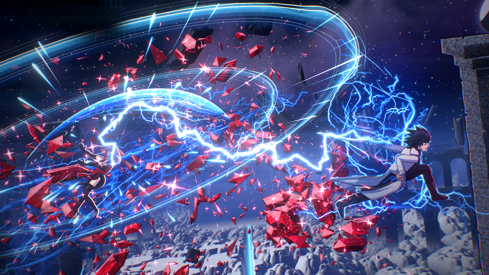

# ISSEN 一閃

A 13-second anime sword fight drawn entirely in JavaScript: no images, no 3D models, no video
footage. Every frame (sky, cloud sea, floating gothic ruins, both characters, the crystals, the
lightning, the crescent slash) is generated by code, then rendered offline to 1080p60.

[](media/ISSEN.mp4)

**Watch: [media/ISSEN.mp4](media/ISSEN.mp4)** (1080p60, 13 s, with sound)

## The film

A swordsman in a white coat and a crystal witch with a crimson scarf face each other on a ruined
plaza above a sea of clouds. She opens with a barrage of red crystals. He flash-steps through it as
lightning, and with a single draw (*issen*, "one flash") the cut splits the cloud sea to the
horizon. Slow motion. He sheathes the blade. The guard clicks home, and only then does the sky
itself fall apart along the line of the cut.

| Shot | Time | |
|---|---|---|
| Standoff | 0.0 – 2.2 | worm's-eye wide; their energies clash between them |
| Hilt | 2.2 – 3.0 | the thumb pushes the guard: *koiguchi o kiru* |
| Eye | 3.0 – 3.9 | the eye snaps open and ignites |
| Barrage | 3.9 – 5.16 | she casts; crystals form and launch |
| Flash step | 5.16 – 6.0 | he vanishes into lightning through the crystals; the shards hang |
| Impact | 6.0 – 6.35 | manga impact frames: he goes through her |
| Issen | 6.35 – 7.9 | the crescent; the wave splits the cloud sea |
| Aftermath | 7.9 – 9.5 | slow motion, he sheathes |
| Chin | 9.5 – 10.2 | the guard meets the scabbard |
| Sky split | 10.2 – 13.0 | the delayed cut tears the sky; title |

## How it works

- **Deterministic frame engine** (`src/core/engine.js`). A film is a pure function of time.
  Four Canvas2D layers: `back` (additive, behind), `scene` (opaque paint), `emit` (additive light,
  in front) and `ui`. Nothing uses `Math.random`; effects "boil" on 24 fps steps like hand-drawn
  anime FX.
- **WebGL2 compositor** (`src/core/gl.js`, `src/core/shaders.js`). It draws a procedural night
  sky (nebula, three star layers, a galaxy, a planet) and a ray-marched, cel-shaded cloud sea that
  can split into a glowing canyon. Then it composites the layers in HDR, with sub-frame motion
  blur, a 7-level bloom, an anamorphic streak, god rays, a soft-knee tonemap, grading, chromatic
  aberration, shockwave refraction, posterised impact frames and film grain.
- **2.5D camera** (`src/core/camera.js`). Pinhole projection with lens shift, roll and shake.
  The world modules project their geometry through it.
- **World** (`src/world/`): about 140 painted ruin sprites, the wet plaza with reflections and
  cracks, and fractured low-poly debris rendered in a private WebGL context.
- **Characters** (`src/chars/`): procedural rigs with IK, chain-simulated cloth, hair and scarf,
  cel shading with rim light, and three macro close-ups (hilt, eye, sheath).
- **FX** (`src/fx/`): lightning trees and auras, crescent slashes, the world-splitting wave,
  faceted 3D crystals that shatter, particles, shockwaves and impact plates.
- **Offline renderer** (`render/render.mjs`). Headless Chrome (GPU) renders each frame, and the
  raw RGBA is piped into ffmpeg (H.264 High, BT.709, yuv420p).
- **Sound** (`audio/`). 55 real sound effects and one music track, all found online under CC0 or
  CC BY. `audio/mix.mjs` places them on the timeline from `audio/cues.json`, measures each clip's
  loudness so levels are set rather than guessed, automates volume, and normalises the mix to
  -14 LUFS with true peaks under -1 dBTP.

## Run it

Requires Node 18+, Google Chrome and ffmpeg on the PATH. If Chrome is not at its default Windows
location, point the `CHROME` environment variable at the executable.

```bash
npm install
npm run serve                                    # live player at http://localhost:8080
node render/render.mjs --times 4.3,6.9 --out out/stills         # stills
node render/render.mjs --video out/picture.mp4 --sub auto       # 1080p60 with motion blur
node audio/mix.mjs --mux out/picture.mp4 out/ISSEN.mp4          # sound mix + mux
```

## Credits

Code: MIT (see `LICENSE`). Sound: see [`audio/CREDITS.md`](audio/CREDITS.md). The music is
"Samurai" by TAD (CC BY 4.0, edited). Made with Claude Code.
